# Next Word Prediction using RNN and LSTM


A beginner-friendly deep learning project that **predicts the next word** and **generates text automatically**. Give a starting text and the number of words you want, and an **LSTM** completes the sentence. A **SimpleRNN** is trained on the same data so you can compare RNN and LSTM side by side.

```
Enter starting text: the crust
How many words to generate: 10
Generated: the crust of global flavors will persist with innovative combinations that reflect
```

## Contents

- [Features](#features)
- [How it works](#how-it-works)
- [Project structure](#project-structure)
- [Quick start](#quick-start)
- [Usage](#usage)
- [Results: RNN vs LSTM](#results-rnn-vs-lstm)
- [RNN vs LSTM in short](#rnn-vs-lstm-in-short)
- [Use your own text](#use-your-own-text)
- [Limitations and improvements](#limitations-and-improvements)
- [Documentation](#documentation)

## Features

- Complete NLP pipeline: sentence splitting, `Tokenizer`, n-gram sequences, padding, one-hot targets
- **SimpleRNN vs LSTM** comparison (parameters, loss, accuracy, training time, curves)
- **Top-k next word suggestions** with probabilities (like a phone keyboard)
- **Text generation** with user input: starting text + number of words
- Greedy decoding and **temperature sampling**
- Runs as a **notebook** or from the **command line**; saves and reloads the model
- Detailed docs: RNN/LSTM theory with equations, line-by-line code walkthrough, interview questions

## How it works

```mermaid
flowchart LR
    A[Text file] --> B[Split into sentences]
    B --> C[Tokenizer: words to integers]
    C --> D[N-gram sequences]
    D --> E[Pad sequences]
    E --> F["X = context words, y = next word"]
    F --> G[Embedding]
    G --> H["LSTM / SimpleRNN"]
    H --> I["Dense + softmax"]
    I --> J[Predicted next word]
    J -->|append and repeat N times| K[Generated text]
```



**Model**

| Layer | Output shape | Parameters |
|---|---|---|
| Embedding (10 dims) | (39, 10) | 6,870 |
| LSTM (128 units) | (128,) | 71,168 |
| Dense softmax (687 words) | (687,) | 88,623 |
| **Total** | | **166,661** |

**Training example.** The first sentence, "Pizza, the delectable and iconic dish ...", becomes (word ids `[3, 1, 233, 2, 45, 35, ...]`):

| Context (X) | Next word (y) |
|---|---|
| pizza | the |
| pizza the | delectable |
| pizza the delectable | and |
| pizza the delectable and | iconic |
| pizza the delectable and iconic | dish |

## Project structure

```
next-word-prediction-lstm/
├── README.md
├── requirements.txt
├── LICENSE
├── .gitignore
├── data/
│   └── pizza.txt                          # training text (about 1,700 words)
├── notebooks/
│   └── Next_Word_Prediction_LSTM.ipynb    # full project with outputs
├── src/
│   └── next_word_lstm.py                  # train + generate from the command line
├── docs/
│   ├── RNN_and_LSTM_Explained.md          # theory, equations, interview questions
│   └── CODE_WALKTHROUGH.md                # step-by-step code explanation
├── images/
│   └── training_comparison.png            # RNN vs LSTM training curves
└── models/                                # saved models (git-ignored)
```

## Quick start

```bash
git clone https://github.com/<your-username>/next-word-prediction-lstm.git
cd next-word-prediction-lstm

python -m venv venv
source venv/bin/activate          # Windows: venv\Scripts\activate

pip install -r requirements.txt
```

## Usage

### Option 1: Jupyter Notebook (recommended for learning)

```bash
jupyter notebook notebooks/Next_Word_Prediction_LSTM.ipynb
```

Run all cells. In section 10 you are asked for a **starting text** and **how many words** to generate (type `q` to stop).

### Option 2: Command line

```bash
# train (first run) and generate 15 words
python src/next_word_lstm.py --seed-text "pizza is" --words 15

# more varied text with temperature sampling
python src/next_word_lstm.py --seed-text "many people" --words 10 --temperature 0.7

# use SimpleRNN instead of LSTM
python src/next_word_lstm.py --model rnn --seed-text "the crust" --words 10

# interactive: asks for the starting text and the number of words
python src/next_word_lstm.py --interactive
```

| Argument | Default | Description |
|---|---|---|
| `--data` | `data/pizza.txt` | training text file |
| `--model` | `lstm` | `lstm` or `rnn` |
| `--epochs` | `200` | training epochs |
| `--seed-text` | `pizza is` | starting text |
| `--words` | `10` | number of words to generate |
| `--temperature` | `0.0` | `0` = most likely word, `0.5-1.0` = more varied |
| `--retrain` | off | ignore saved model and train again |
| `--interactive` | off | ask for input in a loop |

## Results: RNN vs LSTM

Same data (79 sentences, vocabulary of 687 words, 1,628 training sequences), 128 units, 200 epochs:

| Model | Parameters | Final loss | Train accuracy | Training time |
|---|---|---|---|---|
| SimpleRNN | 113,285 | ~0.08 | ~96.5% | ~108 s |
| LSTM | 166,661 | ~0.12 | ~96.3% | ~237 s |


> Both models reach about 96% accuracy because the text is small and they **memorize** it (the SimpleRNN is even a bit lower in loss and 2x faster here). The LSTM's advantage (long-range memory) shows on longer text and bigger datasets. Times are from a CPU run; numbers vary slightly between runs.

**Sample output (LSTM, greedy)**

| Starting text | Generated |
|---|---|
| `pizza is` | pizza is much more than a delicious dish—it is a culinary phenomenon that has |
| `the crust` | the crust of global flavors will persist with innovative combinations that reflect the ever |
| `many people` | many people and augmented reality may even enhance the dining experience allowing customers to |

**Top-5 suggestions**

| Text | Suggestions |
|---|---|
| `pizza is` | much (89%), and (4%), not (3%), a (1%), from (1%) |
| `the crust` | of (99%), and (1%) |
| `many people` | and (93%), from (4%), of (2%) |

Because the model memorizes this one text, greedy and temperature outputs often replay a sentence from the file, and a sentence can jump to another part of the text. That is expected with a single small training file.

## RNN vs LSTM in short

| | SimpleRNN | LSTM |
|---|---|---|
| Memory | one hidden state | hidden state + cell state |
| Gates | none | forget, input, output |
| Parameters per layer | `u x (in + u + 1)` | `4 x u x (in + u + 1)` |
| Long sequences | vanishing gradient | handles much better |
| Speed | faster | slower |

Full explanation with equations: [docs/RNN_and_LSTM_Explained.md](docs/RNN_and_LSTM_Explained.md).

## Use your own text

1. Put your text in `data/your_text.txt` (plain text, normal sentences ending with `.`, `?` or `!`).
2. Notebook: change `DATA_PATH`. Command line: `python src/next_word_lstm.py --data data/your_text.txt --retrain`.
3. More text and more epochs give better results. Seed words must exist in your text.

## Limitations and improvements

- Small dataset (about 1,700 words), so the model memorizes sentences instead of generalizing; there is no validation split.
- Words joined by a dash (`dish—it`) become a single token; clean the text for a better vocabulary.
- Greedy decoding can repeat words. Use temperature sampling.
- Only words seen in training can be predicted.

Ideas to extend: bigger corpus, stacked or `Bidirectional` LSTM, dropout, GRU, pretrained embeddings (GloVe/Word2Vec), a validation set with perplexity, beam search, and finally a Transformer or a pretrained language model.

## Documentation

| File | What you will find |
|---|---|
| [docs/RNN_and_LSTM_Explained.md](docs/RNN_and_LSTM_Explained.md) | RNN, BPTT, vanishing gradient, LSTM gates and equations, GRU, interview questions |
| [docs/CODE_WALKTHROUGH.md](docs/CODE_WALKTHROUGH.md) | every step of the code with shapes and parameter counts, common errors |

## Contact

**Dataloves**: GenAI & Data Science Training Institute
Phone: +91 91404 97404 | Email: ask.dataloves@gmail.com

If this project helped you, give it a ⭐

## License

MIT, see [LICENSE](LICENSE).
